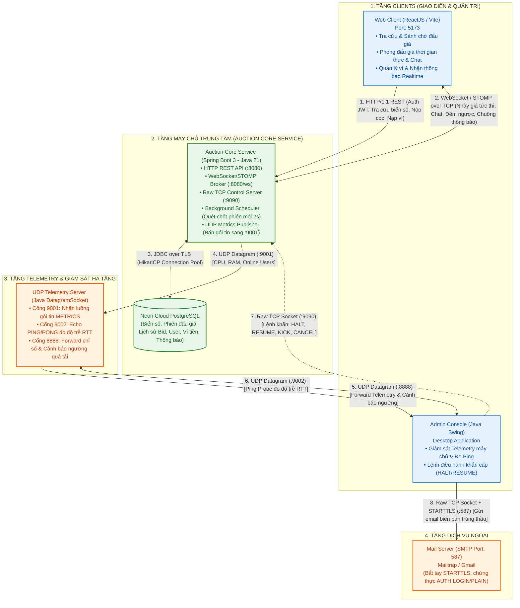
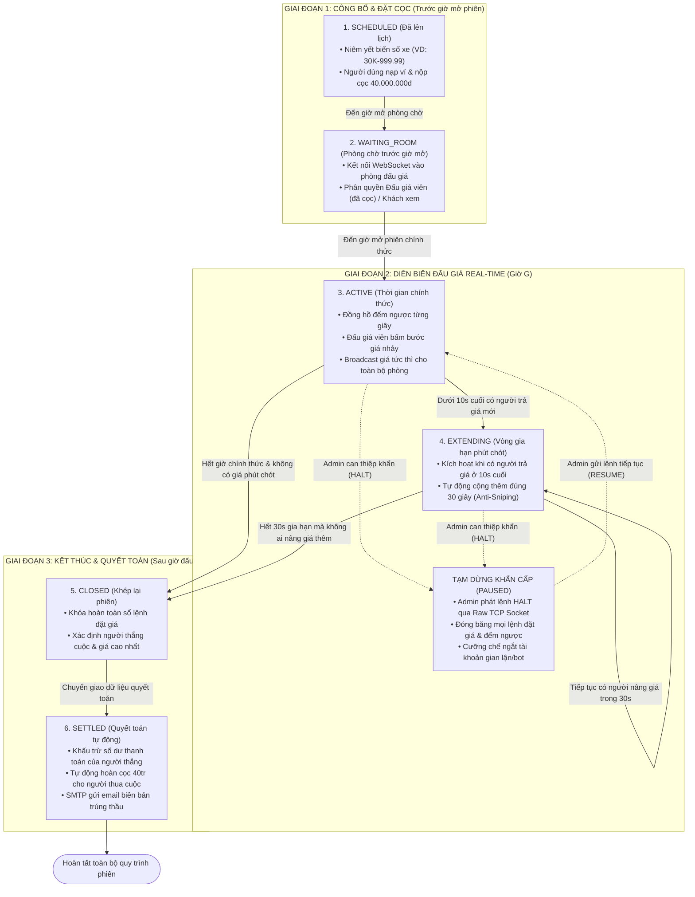

# BÁO CÁO TIẾN ĐỘ DỰ ÁN
## ĐỀ TÀI: SÀN ĐẤU GIÁ TRỰC TUYẾN BIỂN SỐ XE Ô TÔ THEO THỜI GIAN THỰC
> **Môn học:** Lập trình mạng (Java Network Programming - JNP)  
> **Khoa:** Công nghệ thông tin 1 — Học viện Công nghệ Bưu chính Viễn thông (PTIT)  
> **Giảng viên phụ trách:** TS. Đặng Ngọc Hùng  
> **Nguồn tài liệu quản lý:** [Notion Workspace - Dự án sàn đấu giá trực tuyến biển số xe ô tô](https://app.notion.com/p/D-n-s-n-u-gi-tr-c-tuy-n-bi-n-s-xe-t-3ef07e09729380999832da04181769ad)

---

## 1. THÔNG TIN CHUNG VÀ BỐI CẢNH ĐỀ TÀI

### 1.1. Định nghĩa hệ thống
Hệ thống là một **nền tảng đấu giá trực tuyến biển số xe ô tô theo thời gian thực** (mô phỏng quy chuẩn nghiệp vụ theo **Nghị định 39/2023/NĐ-CP**). Nền tảng cho phép người tham gia đăng ký tài khoản, nạp tiền vào ví, nộp tiền đặt trước (ký quỹ 40.000.000 VNĐ) để được cấp quyền vào phòng đấu giá trực tiếp với các tính năng:
- Nhảy giá tức thì đa điểm theo thời gian thực (Real-time Bidding).
- Đồng bộ đồng hồ đếm ngược từng giây giữa máy chủ và người dùng.
- Vòng gia hạn phút chót (Anti-Sniping) tự động cộng 30 giây khi có giá mới ở 10 giây cuối.
- Phòng trò chuyện trực tiếp (Live Chat) giữa các đấu giá viên trong phòng.
- Cơ chế quyết toán và tự động hoàn trả 100% tiền đặt trước cho người không trúng thầu khi phiên kết thúc.
- Bảng điều khiển quản trị độc lập (Admin Console) giám sát hạ tầng mạng và phát lệnh can thiệp phiên khẩn cấp qua kênh Socket riêng biệt.

### 1.2. Tính cấp thiết và bài toán mạng giải quyết
1. **Giá trị tài sản lớn & Toàn vẹn giao dịch:** Biển số xe ô tô đẹp (ngũ quý, tứ quý, sảnh tiến...) có giá trị giao dịch cao; hệ thống bắt buộc phải quản lý ký quỹ minh bạch, không thất thoát tiền cọc và đảm bảo tính nhất quán dữ liệu tuyệt đối.
2. **Đồng thời cao & Độ trễ cực thấp (High Concurrency & Low Latency):** Hàng nghìn người dùng cùng theo dõi và tranh đua đặt giá từng mili-giây. Hạ tầng mạng phải đảm bảo độ trễ dưới 100ms để mọi client nhận được bước giá nhảy đồng thời.
3. **Phòng chống gian lận & Tranh chấp phút chót:** Chống tự đè giá, kiểm tra nguồn thời gian chuẩn (Source of Truth) tại bộ đệm socket của Server để loại bỏ gian lận chỉnh giờ máy client, và áp dụng cơ chế tự động gia hạn 30 giây tránh hiện tượng "bắn tỉa" (sniping).

---

## 2. PHÂN CHIA CÔNG VIỆC VÀ TRÁCH NHIỆM KỸ THUẬT MẠNG

Bảng phân công chi tiết nhiệm vụ và các giao thức mạng phụ trách của từng thành viên:

| STT | Thành viên | Giao thức mạng chịu trách nhiệm | Nhiệm vụ kỹ thuật mạng cụ thể (Phục vụ báo cáo & vấn đáp) |
|:---:|:---|:---|:---|
| 1 | **Nam** | • **WebSocket Server Broker** (:8080/ws) • **HTTP Server (REST API)** (:8080) • **gRPC / RMI Service** (:50051) | - Lập trình Server mở kênh WebSocket trên nền TCP (Port 8080). - Quản lý hàng đợi tin nhắn, broadcast dữ liệu bước giá và đếm ngược cho nhiều client cùng lúc. - Thiết kế đặc tả RESTful API, cơ chế xác thực JWT Stateless. - Xây dựng Background Scheduler định kỳ 2s kiểm tra trạng thái phiên, gọi hàm tự động chốt phiên và quyết toán / hoàn cọc phân tán. |
| 2 | **An** | • **WebSocket / STOMP Client** • **Thuật toán mạng (NTP Sync & Exponential Backoff)** | - Lập trình khung tin STOMP Client: Tự cấu hình và xử lý các Frame mạng (`CONNECT`, `SUBSCRIBE`, `SEND`, `HEARTBEAT`). - Thuật toán bù trừ độ trễ mạng (NTP Clock Sync): Tính toán độ trễ Round-Trip Time (RTT) để đồng bộ đồng hồ đếm ngược với Server chính xác từng mili-giây. - Cơ chế chịu lỗi rớt mạng: Viết thuật toán Auto-Reconnect với Exponential Backoff (tự động thử lại sau 1s, 2s, 4s, 8s...). - Xây dựng toàn bộ giao diện Web Client người dùng (ReactJS, TypeScript, Ant Design). |
| 3 | **Bảo** | • **Raw TCP Socket** (:9090) • **UDP Metrics Server** (:8888, :9001, :9002) • **SMTP Mail Protocol** (:587) | - Lập trình `ServerSocket` TCP thuần trên Port 9090: Đọc luồng byte stream nhận và xử lý lệnh điều hành khẩn cấp (`HALT`, `RESUME`, `KICK`, `CANCEL`). - Lập trình `DatagramSocket` UDP trên server: Tiếp nhận telemetry CPU/RAM, phản hồi Echo Ping/Pong đo độ trễ RTT. - Lập trình ứng dụng Desktop Admin Console (Java Swing) giám sát đồ họa. - Lập trình gửi email tự động qua giao thức SMTP (STARTTLS) gửi biên bản trúng đấu giá kèm mã QR. |

---

## 3. CÁC CHỨC NĂNG ĐÃ TRIỂN KHAI HOÀN THIỆN

### 3.1. Sảnh chờ và tra cứu danh mục biển số (Lobby & Discovery)
- **Bộ lọc đa tiêu chí:** Cho phép người dùng tìm kiếm, lọc biển số theo Tỉnh / Thành phố (Hà Nội, TP.HCM, Đà Nẵng...) và theo loại biển số phong thủy (Ngũ quý, Tứ quý, Tam hoa, Sảnh tiến, Lộc phát, Thần tài).
- **Phân loại 3 trạng thái phiên:** Sắp diễn ra (`SCHEDULED`), Đang diễn ra (`ACTIVE`), Đã kết thúc (`CLOSED` / `SETTLED`).
- **Real-time Live Sync:** Sảnh chờ tự động kết nối WebSocket lắng nghe liên tục; mức giá hiện tại và số lượt trả giá trên từng thẻ biển số tự động nhảy số tức thì khi có người đặt giá trong phòng mà không cần tải lại trang.

### 3.2. Phòng đấu giá trực tuyến thời gian thực (Core Bidding Room)
- **Giao diện đấu giá tập trung:** Hiển thị biển số xe nổi bật viền vàng, thông tin xe, giá khởi điểm, mức giá hiện tại, người đang nắm giữ mức giá cao nhất.
- **Bàn phím bước giá nhanh:** Hỗ trợ các nút tăng giá nhanh chuẩn quy định (+5 triệu, +10 triệu, +20 triệu, +50 triệu) và nhập số tiền tùy chọn hợp lệ.
- **Đồng hồ đếm ngược đồng bộ:** Đếm ngược từng giây theo thời gian thực từ Server.
- **Vòng gia hạn phút chót (Anti-Sniping):** Nếu có lượt đặt giá hợp lệ trong 10 giây cuối cùng, hệ thống tự động cộng thêm đúng 30 giây để đảm bảo công bằng.
- **Âm thanh & Live Chat:** Tích hợp âm thanh chuông gõ búa khi có bước giá mới, khung trò chuyện trực tuyến giữa các đấu giá viên trong phòng.
- **Chống tự đè giá:** Người đang dẫn đầu mức giá cao nhất bị vô hiệu hóa nút đặt giá tiếp theo.

### 3.3. Quản lý phiên và tự động quyết toán ngầm (Automated Lifecycle & Settlement)
- **Background Scheduler:** Tiến trình nền định kỳ mỗi 2 giây quét kiểm tra vòng đời phiên đấu giá.
- **Tự động mở phiên:** Đúng giờ bắt đầu, phiên tự động chuyển từ `SCHEDULED` sang `ACTIVE`.
- **Tự động đóng phiên & Quyết toán:** Khi hết thời gian chính thức (hoặc hết thời gian gia hạn), hệ thống tự động:
  1. Khóa sổ lệnh đặt giá.
  2. Xác định người trả giá cao nhất và giá trúng đấu giá chính thức.
  3. Khấu trừ số dư thanh toán của người trúng thầu.
  4. Tự động giải phóng và hoàn trả nguyên vẹn 100% tiền đặt trước (40.000.000 VNĐ) cho toàn bộ người tham gia không trúng thầu.
  5. Phát sóng thông báo kết quả trúng thầu đến toàn bộ client đang theo dõi.

### 3.4. Giám sát hạ tầng và đo lường độ trễ mạng (UDP Telemetry & Network Health)
- **Giao thức UDP không kết nối:** Thu thập thông số máy chủ với gói tin siêu nhẹ để không gây áp lực tải lên luồng Web.
- **Thu thập chỉ số tức thời:** Định kỳ mỗi giây đóng gói thông số % CPU, dung lượng RAM sử dụng và số lượng kết nối gửi về trung tâm giám sát.
- **Đo Ping RTT:** Gửi gói tin Ping/Pong qua cổng 9002 để đo Round-Trip Time, hiển thị cột sóng mạng (Xanh < 50ms, Vàng 50-150ms, Đỏ > 150ms) trên giao diện quản trị.
- **Cảnh báo quá tải:** Tự động phát tín hiệu cảnh báo khi máy chủ chạm ngưỡng tài nguyên tới hạn.

### 3.5. Điều hành khẩn cấp và gửi biên bản qua email (Emergency Control & SMTP)
- **Kênh điều hành TCP Socket 9090 độc lập:** Quản trị viên sử dụng Admin Console phát các lệnh điều khiển khẩn cấp dạng text trực tiếp vào socket:
  - `HALT <sessionId>`: Đóng băng phiên ngay lập tức khi phát hiện nghi vấn gian lận hoặc sự cố mạng.
  - `RESUME <sessionId>`: Mở lại phiên đấu giá và tự động bù thêm 30 giây.
  - `KICK <userId>`: Cưỡng chế ngắt kết nối WebSocket đối với tài khoản vi phạm hoặc bot spam.
  - `CANCEL <sessionId>`: Hủy phiên đấu giá và kích hoạt quy trình hoàn tiền cọc an toàn.
- **Biên bản xác nhận trúng thầu (SMTP 587):** Tự động soạn thảo và gửi email hóa đơn điện tử kèm mã QR xác thực về hòm thư người thắng cuộc ngay sau khi phiên kết thúc.

### 3.6. Các tính năng nâng cấp mở rộng mới nhất
1. **Hệ thống thông báo Realtime & Chuông Header:**
   - Thêm dropdown danh sách thông báo dạng popover chuẩn nhận diện, hiển thị số thông báo chưa đọc, lọc *Tất cả* / *Chưa đọc*, đánh dấu đã đọc.
   - Bắn thông báo thời gian thực qua kênh riêng `/user/queue/notifications`.
   - Tự động lưu DB và bắn thông báo khi **Nạp tiền ví thành công** (`WALLET_TOPUP`), **Đặt giá thành công** (`BID_SUCCESS`), và **Trúng đấu giá** (`ENDED_WON`).
2. **Trang thông tin cá nhân (Profile) & Quản lý ví:**
   - Hiển thị thông tin cá nhân: Họ tên, email, vai trò hệ thống, trạng thái tài khoản.
   - Thẻ hiển thị số dư ví đấu giá demo với nút nạp tiền trực quan.
   - Modal nạp tiền chuẩn `ModalForm` tích hợp các preset chọn nhanh (+5tr, +10tr, +20tr, +50tr, +100tr, +500tr) và ô nhập tiền tùy chọn định dạng VNĐ.
3. **Phân quyền Đấu giá viên chính thức và Khách theo dõi:**
   - Phân biệt người dùng đã nộp đủ cọc 40 triệu VNĐ (có quyền bấm trả giá và chat) và khách vãng lai/chưa cọc (chỉ xem giá nhảy và đếm ngược).
4. **Phát hiện và cảnh báo thổi giá (Shill Bidding Detection):**
   - Tự động giám sát và cảnh báo khi có 2 tài khoản liên tục trả giá qua lại bất thường trong khoảng thời gian ngắn (dưới 15 giây).
5. **Cảnh báo bị vượt giá (Outbid Alert):**
   - Thông báo tức thời đến người đang dẫn đầu ngay khi có đấu giá viên khác đặt mức giá cao hơn.
6. **Đấu giá tự động (Auto-Bidding Engine):**
   - Hỗ trợ người dùng thiết lập mức giá trần và tự động đặt giá sau khoảng trễ 5 giây + khoảng ngẫu nhiên (random ms) để tránh xung đột nghẽn socket và hành vi spam máy móc.
7. **Bước giá lũy tiến linh hoạt:**
   - Tự động điều chỉnh bước giá tối thiểu theo thang giá trị hiện tại của biển số:
     - Dưới 100 triệu: Bước giá tối thiểu **+5 triệu VNĐ**.
     - Từ 100 - 500 triệu: Bước giá tối thiểu **+10 triệu VNĐ**.
     - Trên 500 triệu: Bước giá tối thiểu **+20 triệu VNĐ**.

---

## 4. KIẾN TRÚC HỆ THỐNG VÀ LUỒNG GIAO TIẾP MẠNG

### 4.1. Sơ đồ kiến trúc 4 tầng phân tán

### 4.2. Chi tiết các giao thức mạng được triển khai

| Giao thức | Tầng mạng | Cổng (Port) | Thành phần kết nối | Mục đích kỹ thuật |
|:---|:---:|:---:|:---|:---|
| **HTTP / REST** | Tầng ứng dụng (Application) | `8080` | Web Client $\leftrightarrow$ Core Server | Giao tiếp phi trạng thái (Stateless), phục vụ xác thực JWT, tra cứu danh mục biển số, quản lý hồ sơ và nộp cọc. |
| **WebSocket / STOMP** | Tầng ứng dụng trên nền TCP | `8080` (`/ws`) | Web Client $\leftrightarrow$ STOMP Broker | Kênh truyền song công liên tục (Full-duplex), phát sóng bước giá mới tức thời, tin nhắn chat phòng và thông báo cá nhân hóa. |
| **Raw TCP Socket** | Tầng giao vận (Transport) | `9090` | Admin Console $\rightarrow$ Core TCP Listener | Kênh truyền luồng byte trực tiếp, bảo đảm độ ưu tiên tuyệt đối để can thiệp phiên khẩn cấp ngay cả khi Web API quá tải. |
| **UDP Datagram** | Tầng giao vận (Transport) | `8888`, `9001`, `9002` | Core Server $\leftrightarrow$ UDP Server $\leftrightarrow$ Admin | Giao thức không kết nối siêu nhẹ, truyền tải thông số Telemetry (CPU/RAM/Users) và gói tin Ping/Pong đo độ trễ RTT. |
| **SMTP / STARTTLS** | Tầng ứng dụng trên nền TCP | `587` | Admin / Core $\rightarrow$ Mail Server | Gửi email biên bản xác nhận trúng đấu giá tự động kèm mã QR và hóa đơn điện tử cho người thắng cuộc. |
| **JDBC over TLS** | Tầng ứng dụng trên TCP có mã hóa | `5432` | Core Server $\leftrightarrow$ PostgreSQL DB | Truy vấn và lưu trữ dữ liệu an toàn qua kết nối mạng được mã hóa TLS với cơ chế connection pool HikariCP. |

---

## 5. QUY CHUẨN NGHIỆP VỤ VÀ VÒNG ĐỜI PHIÊN ĐẤU GIÁ

### 5.1. Sơ đồ trạng thái phiên đấu giá

### 5.2. Quy tắc đặt giá và tính toán bước giá
- **Giá khởi điểm:** Cố định **40.000.000 VNĐ** theo quy định tại Nghị định 39/2023/NĐ-CP đối với biển số xe ô tô.
- **Tiền đặt trước (Ký quỹ):** Cố định **40.000.000 VNĐ**. Người dùng phải nộp đủ tiền cọc trước khi phiên bắt đầu để nhận quyền đấu giá viên chính thức.
- **Quy tắc bước giá lũy tiến:**
  $$\text{Bước giá tối thiểu} = \begin{cases} 5.000.000\text{ VNĐ} & \text{khi Giá hiện tại} < 100.000.000\text{ VNĐ} \\ 10.000.000\text{ VNĐ} & \text{khi } 100.000.000 \le \text{Giá hiện tại} \le 500.000.000\text{ VNĐ} \\ 20.000.000\text{ VNĐ} & \text{khi Giá hiện tại} > 500.000.000\text{ VNĐ} \end{cases}$$
- **Nguyên tắc đóng dấu thời gian (Timestamp Source of Truth):** Lệnh đặt giá được đóng dấu thời gian tại thời điểm gói tin đến Socket Buffer của Server; đảm bảo tính công bằng theo thứ tự *First-Come, First-Served* và loại bỏ hoàn toàn gian lận sai lệch đồng hồ máy khách.

---

## 6. KẾ HOẠCH VÀ HƯỚNG PHÁT TRIỂN TIẾP THEO

1. **Đấu nối trực tiếp TCP Socket 9090:** Hoàn thiện kết nối trực tiếp từ các nút bấm trên giao diện Admin Console (Java Swing) vào cổng Raw TCP Socket của Core Service để gửi và nhận phản hồi tức thời từ tiến trình máy chủ.
2. **Thuật toán bù trừ độ trễ mạng (NTP Clock Sync):** Xây dựng module tính toán RTT giữa Client và Server nhằm hiệu chỉnh đồng hồ đếm ngược phòng đấu giá chính xác tới từng mili-giây, bù đắp sai lệch thời gian do độ trễ truyền dẫn mạng.
3. **Tối ưu cơ chế Auto-Reconnect (Exponential Backoff):** Bổ sung thuật toán tự động kết nối lại thông minh cho cả Web Client STOMP và Desktop TCP Console khi đường truyền Internet gặp sự cố ngắt kết nối đột ngột mà không làm gián đoạn trạng thái phiên người dùng.
4. **Hoàn thiện tài liệu và kịch bản demo:** Cập nhật đầy đủ file `README.md` ở thư mục gốc, bổ sung ảnh chụp demo kết quả đấu giá vào thư mục `statics/`, và chuẩn bị slide thuyết trình phục vụ buổi vấn đáp trực tiếp với giảng viên.

---
*Báo cáo được tổng hợp và đối soát tự động từ tài liệu thiết kế và mã nguồn thực tế của dự án.*

