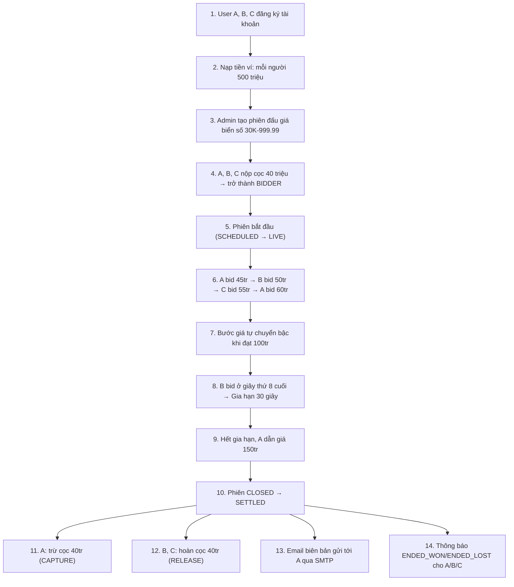

# KỊCH BẢN KIỂM THỬ HỆ THỐNG ĐẤU GIÁ BIỂN SỐ XE Ô TÔ TRỰC TUYẾN

> **Dự án:** Sàn đấu giá trực tuyến biển số xe ô tô theo thời gian thực  
> **Phiên bản:** v1.0 — Ngày tạo: 16/11/2026  
> **Phạm vi:** Toàn bộ hệ thống (Web Client ReactJS + Auction Core Service Spring Boot + Admin Console Java Swing + UDP Telemetry Server + SMTP Mailer)

---

## MỤC LỤC

1. [Quy ước chung](#1-quy-ước-chung)
2. [Module 1 — Đăng ký / Đăng nhập / Quản lý tài khoản](#2-module-1--đăng-ký--đăng-nhập--quản-lý-tài-khoản)
3. [Module 2 — Ví tiền ảo & Nạp tiền](#3-module-2--ví-tiền-ảo--nạp-tiền)
4. [Module 3 — Sảnh chờ & Tra cứu biển số](#4-module-3--sảnh-chờ--tra-cứu-biển-số)
5. [Module 4 — Đăng ký đấu giá & Nộp cọc](#5-module-4--đăng-ký-đấu-giá--nộp-cọc)
6. [Module 5 — Phòng đấu giá trực tuyến (Core Bidding)](#6-module-5--phòng-đấu-giá-trực-tuyến-core-bidding)
7. [Module 6 — Bước giá lũy tiến](#7-module-6--bước-giá-lũy-tiến)
8. [Module 7 — Đồng hồ đếm ngược & Vòng gia hạn (Anti-Sniping)](#8-module-7--đồng-hồ-đếm-ngược--vòng-gia-hạn-anti-sniping)
9. [Module 8 — Chat trực tiếp trong phòng](#9-module-8--chat-trực-tiếp-trong-phòng)
10. [Module 9 — Cảnh báo bị vượt giá (Outbid Alert)](#10-module-9--cảnh-báo-bị-vượt-giá-outbid-alert)
11. [Module 10 — Đấu giá tự động (Auto-Bid)](#11-module-10--đấu-giá-tự-động-auto-bid)
12. [Module 11 — Kết thúc phiên & Quyết toán tự động](#12-module-11--kết-thúc-phiên--quyết-toán-tự-động)
13. [Module 12 — Hệ thống thông báo Realtime](#13-module-12--hệ-thống-thông-báo-realtime)
14. [Module 13 — Theo dõi phiên (⭐ Watch)](#14-module-13--theo-dõi-phiên--watch)
15. [Module 14 — Lịch sử đấu giá & Biểu đồ giá](#15-module-14--lịch-sử-đấu-giá--biểu-đồ-giá)
16. [Module 15 — Phát hiện thổi giá (Shill Bidding Detection)](#16-module-15--phát-hiện-thổi-giá-shill-bidding-detection)
17. [Module 16 — Admin: Giám sát & Điều hành phiên](#17-module-16--admin-giám-sát--điều-hành-phiên)
18. [Module 17 — Admin Console (Java Swing) & TCP/UDP](#18-module-17--admin-console-java-swing--tcpudp)
19. [Module 18 — SMTP Gửi email biên bản trúng thầu](#19-module-18--smtp-gửi-email-biên-bản-trúng-thầu)
20. [Module 19 — Phân quyền & Bảo mật](#20-module-19--phân-quyền--bảo-mật)
21. [Module 20 — Hiệu năng & Độ ổn định mạng](#21-module-20--hiệu-năng--độ-ổn-định-mạng)
22. [Kịch bản tích hợp End-to-End](#22-kịch-bản-tích-hợp-end-to-end)

---

## 1. Quy ước chung

| Ký hiệu | Ý nghĩa |
|:---:|:---|
| ✅ | Kết quả mong đợi (expected) |
| ❌ | Kết quả lỗi / bị từ chối (negative test) |
| 🔄 | Cần kiểm tra tự động / tải đồng thời |
| 📡 | Liên quan đến giao thức mạng (WebSocket, TCP, UDP, SMTP) |
| 🔒 | Liên quan đến phân quyền / bảo mật |

**Vai trò test:**
- **User A, B, C** — Người dùng thường (đấu giá viên hoặc khách xem)
- **Admin** — Quản trị viên hệ thống

---

## 2. Module 1 — Đăng ký / Đăng nhập / Quản lý tài khoản

### TC-1.1: Đăng ký tài khoản mới thành công

| Mục | Nội dung |
|:---|:---|
| **Tiền điều kiện** | Chưa có tài khoản |
| **Bước thực hiện** | 1. Truy cập trang đăng ký 2. Nhập đầy đủ: Họ tên, Email, Mật khẩu, Xác nhận mật khẩu 3. Bấm "Đăng ký" |
| **Kết quả mong đợi** | ✅ Tạo tài khoản thành công, chuyển về trang đăng nhập hoặc tự đăng nhập ✅ Ví tiền được tạo tự động với số dư khởi tạo 1.000.000.000 VNĐ |

### TC-1.2: Đăng ký trùng email

| Mục | Nội dung |
|:---|:---|
| **Tiền điều kiện** | Email đã tồn tại trong hệ thống |
| **Bước thực hiện** | Đăng ký với email đã đăng ký trước đó |
| **Kết quả mong đợi** | ❌ Thông báo lỗi "Email đã tồn tại" |

### TC-1.3: Đăng nhập thành công

| Mục | Nội dung |
|:---|:---|
| **Tiền điều kiện** | Tài khoản đã đăng ký |
| **Bước thực hiện** | 1. Nhập email + mật khẩu đúng 2. Bấm "Đăng nhập" |
| **Kết quả mong đợi** | ✅ Nhận JWT Token, chuyển vào trang chính ✅ Header hiển thị tên người dùng |

### TC-1.4: Đăng nhập sai mật khẩu

| Mục | Nội dung |
|:---|:---|
| **Tiền điều kiện** | Tài khoản đã đăng ký |
| **Bước thực hiện** | Nhập email đúng + mật khẩu sai |
| **Kết quả mong đợi** | ❌ Thông báo lỗi, không cấp token |

### TC-1.5: Xem trang thông tin cá nhân (Profile)

| Mục | Nội dung |
|:---|:---|
| **Tiền điều kiện** | Đã đăng nhập |
| **Bước thực hiện** | Vào trang Profile |
| **Kết quả mong đợi** | ✅ Hiển thị đúng: Họ tên, Email, Vai trò, Trạng thái tài khoản ✅ Hiển thị thẻ số dư ví đấu giá |

---

## 3. Module 2 — Ví tiền ảo & Nạp tiền

### TC-2.1: Xem số dư ví

| Mục | Nội dung |
|:---|:---|
| **Tiền điều kiện** | Đã đăng nhập |
| **Bước thực hiện** | Gọi `GET /api/v1/wallet` hoặc vào trang Profile |
| **Kết quả mong đợi** | ✅ Trả về `balance`, `heldAmount`, `available` (available = balance − heldAmount) |

### TC-2.2: Nạp tiền ảo thành công

| Mục | Nội dung |
|:---|:---|
| **Tiền điều kiện** | Đã đăng nhập, mở Modal nạp tiền |
| **Bước thực hiện** | 1. Chọn preset +50.000.000 VNĐ 2. Bấm "Nạp tiền" |
| **Kết quả mong đợi** | ✅ Số dư tăng thêm 50.000.000 VNĐ ✅ Ghi `WalletTransaction` type `TOPUP` ✅ Nhận thông báo realtime `WALLET_TOPUP` |

### TC-2.3: Nạp tiền vượt giới hạn

| Mục | Nội dung |
|:---|:---|
| **Bước thực hiện** | Nạp số tiền > 500.000.000 VNĐ / lần |
| **Kết quả mong đợi** | ❌ Từ chối với lỗi `TOPUP_INVALID_AMOUNT` |

### TC-2.4: Nạp tiền số âm hoặc bằng 0

| Mục | Nội dung |
|:---|:---|
| **Bước thực hiện** | Nhập số tiền ≤ 0 |
| **Kết quả mong đợi** | ❌ Từ chối với lỗi `TOPUP_INVALID_AMOUNT` |

### TC-2.5: 🔄 Nạp tiền đồng thời (Concurrent Topup)

| Mục | Nội dung |
|:---|:---|
| **Bước thực hiện** | Gửi đồng thời 5 request nạp +10.000.000 VNĐ |
| **Kết quả mong đợi** | ✅ Tổng số dư tăng đúng 50.000.000 VNĐ, không bị mất tiền ✅ Có đúng 5 bản ghi `WalletTransaction` |

---

## 4. Module 3 — Sảnh chờ & Tra cứu biển số

### TC-3.1: Xem danh sách phiên đấu giá

| Mục | Nội dung |
|:---|:---|
| **Bước thực hiện** | Truy cập trang Sảnh chờ / Dashboard |
| **Kết quả mong đợi** | ✅ Hiển thị danh sách biển số theo 3 tab: Sắp diễn ra (SCHEDULED), Đang diễn ra (ACTIVE/LIVE), Đã kết thúc (CLOSED/SETTLED) |

### TC-3.2: Lọc biển số theo tỉnh / thành phố

| Mục | Nội dung |
|:---|:---|
| **Bước thực hiện** | Chọn bộ lọc "Hà Nội" (30) |
| **Kết quả mong đợi** | ✅ Chỉ hiển thị các biển số vùng Hà Nội |

### TC-3.3: Lọc biển số theo loại phong thủy

| Mục | Nội dung |
|:---|:---|
| **Bước thực hiện** | Chọn bộ lọc "Ngũ quý" |
| **Kết quả mong đợi** | ✅ Chỉ hiển thị các biển số dạng ngũ quý (99999, 88888...) |

### TC-3.4: 📡 Sảnh chờ cập nhật realtime

| Mục | Nội dung |
|:---|:---|
| **Tiền điều kiện** | User A đang ở Sảnh chờ; User B đang đặt giá trong phòng |
| **Bước thực hiện** | User B đặt giá thành công trong phòng đấu giá |
| **Kết quả mong đợi** | ✅ Thẻ biển số trên Sảnh chờ của User A tự động nhảy số giá hiện tại và số lượt trả giá mà không cần F5 (qua kênh `/topic/auctions`) |

---

## 5. Module 4 — Đăng ký đấu giá & Nộp cọc

### TC-4.1: Đăng ký đấu giá thành công (nộp cọc 40 triệu)

| Mục | Nội dung |
|:---|:---|
| **Tiền điều kiện** | Số dư khả dụng ≥ 40.000.000 VNĐ, phiên ở trạng thái SCHEDULED hoặc LIVE |
| **Bước thực hiện** | 1. Vào phòng đấu giá 2. Bấm "Đăng ký đấu giá" 3. Xác nhận nộp cọc |
| **Kết quả mong đợi** | ✅ `heldAmount` tăng 40.000.000 VNĐ, `available` giảm tương ứng ✅ Tạo `AuctionRegistration` status ACTIVE ✅ Ghi `WalletTransaction` type HOLD ✅ Vai trò chuyển từ VIEWER → BIDDER ✅ Nhận `ROLE_CHANGED` qua `/user/queue/room-role`, giao diện đổi ngay (hiện nút đặt giá) |

### TC-4.2: Đăng ký đấu giá khi không đủ tiền

| Mục | Nội dung |
|:---|:---|
| **Tiền điều kiện** | Số dư khả dụng < 40.000.000 VNĐ |
| **Bước thực hiện** | Bấm "Đăng ký đấu giá" |
| **Kết quả mong đợi** | ❌ Từ chối với lỗi `WALLET_INSUFFICIENT` |

### TC-4.3: Đăng ký đấu giá 2 lần cùng phiên

| Mục | Nội dung |
|:---|:---|
| **Tiền điều kiện** | Đã đăng ký phiên này |
| **Bước thực hiện** | Bấm "Đăng ký đấu giá" lần 2 |
| **Kết quả mong đợi** | ❌ Từ chối với lỗi `ALREADY_REGISTERED` |

### TC-4.4: Hủy đăng ký khi phiên còn SCHEDULED

| Mục | Nội dung |
|:---|:---|
| **Tiền điều kiện** | Đã đăng ký, phiên SCHEDULED |
| **Bước thực hiện** | Gọi `DELETE /api/v1/auction/{code}/register` |
| **Kết quả mong đợi** | ✅ Hoàn trả cọc (`RELEASE`), `heldAmount` giảm 40.000.000 VNĐ ✅ `AuctionRegistration` status → CANCELLED ✅ Vai trò chuyển về VIEWER |

### TC-4.5: Hủy đăng ký khi phiên đang LIVE

| Mục | Nội dung |
|:---|:---|
| **Tiền điều kiện** | Đã đăng ký, phiên LIVE |
| **Bước thực hiện** | Gọi `DELETE /api/v1/auction/{code}/register` |
| **Kết quả mong đợi** | ❌ Từ chối — không cho hủy khi phiên đang diễn ra |

---

## 6. Module 5 — Phòng đấu giá trực tuyến (Core Bidding)

### TC-5.1: 📡 Vào phòng đấu giá và kết nối WebSocket

| Mục | Nội dung |
|:---|:---|
| **Bước thực hiện** | 1. Đăng nhập 2. Bấm vào biển số đang LIVE 3. Vào phòng đấu giá |
| **Kết quả mong đợi** | ✅ Kết nối WebSocket/STOMP thành công qua `:8080/ws` ✅ Hiển thị: Biển số xe nổi bật, giá hiện tại, giá khởi điểm, đồng hồ đếm ngược, danh sách bước giá |

### TC-5.2: Đặt giá thành công (BIDDER)

| Mục | Nội dung |
|:---|:---|
| **Tiền điều kiện** | Vai trò BIDDER, phiên LIVE, không phải người đang dẫn giá |
| **Bước thực hiện** | Bấm nút "+5 triệu" |
| **Kết quả mong đợi** | ✅ Giá tăng đúng 5.000.000 VNĐ ✅ Tất cả client trong phòng nhận broadcast giá mới qua `/topic/auction/{code}` ✅ Ghi `BidHistory` với `isWinningBid = true`, `previousPrice`, `stepApplied` ✅ Nhận thông báo `BID_SUCCESS` |

### TC-5.3: Khách xem (VIEWER) đặt giá bị từ chối

| Mục | Nội dung |
|:---|:---|
| **Tiền điều kiện** | Vai trò VIEWER (chưa nộp cọc) |
| **Bước thực hiện** | Gửi lệnh bid qua WebSocket (bypass UI) |
| **Kết quả mong đợi** | ❌ Nhận lỗi `AUCTION_NOT_REGISTERED` qua `/user/queue/errors` 🔒 BE chặn, không chỉ ẩn nút ở FE |

### TC-5.4: Chống tự đè giá (người dẫn đầu không tự trả giá tiếp)

| Mục | Nội dung |
|:---|:---|
| **Tiền điều kiện** | User A đang nắm giá cao nhất |
| **Bước thực hiện** | User A bấm đặt giá tiếp |
| **Kết quả mong đợi** | ❌ Từ chối với lỗi `ALREADY_LEADING` ✅ Các nút đặt giá bị vô hiệu hóa trên giao diện |

### TC-5.5: Đặt giá khi phiên PAUSED

| Mục | Nội dung |
|:---|:---|
| **Tiền điều kiện** | Admin đã HALT phiên |
| **Bước thực hiện** | Bấm đặt giá |
| **Kết quả mong đợi** | ❌ Từ chối với lỗi `AUCTION_NOT_LIVE` |

### TC-5.6: Đặt giá khi phiên đã END

| Mục | Nội dung |
|:---|:---|
| **Tiền điều kiện** | Phiên đã kết thúc |
| **Bước thực hiện** | Gửi lệnh bid qua WebSocket |
| **Kết quả mong đợi** | ❌ Từ chối với lỗi `AUCTION_NOT_LIVE` |

### TC-5.7: 🔄 Hai người đặt giá đồng thời (Race Condition)

| Mục | Nội dung |
|:---|:---|
| **Tiền điều kiện** | User A và User B cùng là BIDDER, giá hiện tại = 50.000.000 |
| **Bước thực hiện** | A và B đồng thời gửi bid +5.000.000 |
| **Kết quả mong đợi** | ✅ Chỉ 1 người thành công (First-Come, First-Served) ✅ Người còn lại nhận lỗi `BID_TOO_LOW` hoặc `ALREADY_LEADING` 🔄 Pessimistic Lock `findBySessionCodeForUpdate` đảm bảo không ghi đè |

### TC-5.8: 📡 Broadcast giá mới cho toàn bộ phòng

| Mục | Nội dung |
|:---|:---|
| **Tiền điều kiện** | 5 client đang trong phòng (3 BIDDER + 2 VIEWER) |
| **Bước thực hiện** | 1 BIDDER đặt giá thành công |
| **Kết quả mong đợi** | ✅ Tất cả 5 client nhận tin nhắn mới qua `/topic/auction/{code}` với giá mới, `nextStep`, `nextMinBid` trong vòng < 1 giây |

---

## 7. Module 6 — Bước giá lũy tiến

### TC-6.1: Bước giá khi giá hiện tại < 100 triệu

| Mục | Nội dung |
|:---|:---|
| **Tiền điều kiện** | Giá hiện tại = 95.000.000 VNĐ |
| **Kết quả mong đợi** | ✅ Bước giá tối thiểu = 5.000.000 VNĐ ✅ `nextMinBid` = 100.000.000 VNĐ |

### TC-6.2: Bước giá chuyển bậc tại biên 100 triệu

| Mục | Nội dung |
|:---|:---|
| **Tiền điều kiện** | Giá hiện tại = 100.000.000 VNĐ (vừa đạt mốc) |
| **Kết quả mong đợi** | ✅ Bước giá tối thiểu chuyển thành 10.000.000 VNĐ ✅ `nextMinBid` = 110.000.000 VNĐ |

### TC-6.3: Bước giá khi giá hiện tại 100 – 500 triệu

| Mục | Nội dung |
|:---|:---|
| **Tiền điều kiện** | Giá hiện tại = 300.000.000 VNĐ |
| **Kết quả mong đợi** | ✅ Bước giá tối thiểu = 10.000.000 VNĐ |

### TC-6.4: Bước giá chuyển bậc tại biên 500 triệu

| Mục | Nội dung |
|:---|:---|
| **Tiền điều kiện** | Giá hiện tại = 500.000.000 VNĐ |
| **Kết quả mong đợi** | ✅ Bước giá = 10.000.000 VNĐ (vẫn thuộc bậc 100–500tr) ✅ Sau khi bid lên 510 triệu → bước giá chuyển thành 20.000.000 VNĐ |

### TC-6.5: Bid sai bước giá bị từ chối

| Mục | Nội dung |
|:---|:---|
| **Tiền điều kiện** | Giá hiện tại = 50.000.000, bước giá = 5.000.000 |
| **Bước thực hiện** | Gửi bid 53.000.000 VNĐ (không phải bội số của bước giá) |
| **Kết quả mong đợi** | ❌ Từ chối với lỗi `BID_INVALID_STEP` |

### TC-6.6: Bid thấp hơn giá tối thiểu bị từ chối

| Mục | Nội dung |
|:---|:---|
| **Tiền điều kiện** | Giá hiện tại = 50.000.000, nextMinBid = 55.000.000 |
| **Bước thực hiện** | Gửi bid 51.000.000 VNĐ |
| **Kết quả mong đợi** | ❌ Từ chối với lỗi `BID_TOO_LOW` |

---

## 8. Module 7 — Đồng hồ đếm ngược & Vòng gia hạn (Anti-Sniping)

### TC-7.1: 📡 Đồng hồ đếm ngược đồng bộ

| Mục | Nội dung |
|:---|:---|
| **Tiền điều kiện** | Phiên LIVE, 3 client đang trong phòng |
| **Kết quả mong đợi** | ✅ Cả 3 client hiển thị thời gian đếm ngược sai lệch ≤ 1 giây ✅ Thời gian được đồng bộ từ server (source of truth) |

### TC-7.2: Vòng gia hạn khi có bid trong 10 giây cuối

| Mục | Nội dung |
|:---|:---|
| **Tiền điều kiện** | Phiên LIVE, còn 8 giây |
| **Bước thực hiện** | User A đặt giá ở giây thứ 8 trước khi hết giờ |
| **Kết quả mong đợi** | ✅ Phiên chuyển sang EXTENDING ✅ Đồng hồ cộng thêm đúng 30 giây ✅ Tất cả client nhận thông báo gia hạn |

### TC-7.3: Gia hạn liên tiếp

| Mục | Nội dung |
|:---|:---|
| **Tiền điều kiện** | Đang trong vòng gia hạn 30s, còn 5 giây |
| **Bước thực hiện** | Có người trả giá mới |
| **Kết quả mong đợi** | ✅ Đồng hồ đặt lại về 30 giây mới ✅ Tiếp tục gia hạn cho đến khi hết 30s mà không ai trả giá |

### TC-7.4: Kết thúc sau gia hạn

| Mục | Nội dung |
|:---|:---|
| **Tiền điều kiện** | Đang EXTENDING |
| **Bước thực hiện** | Hết 30 giây gia hạn, không ai trả giá thêm |
| **Kết quả mong đợi** | ✅ Phiên chuyển sang CLOSED → SETTLED ✅ Xác định đúng người thắng cuộc |

---

## 9. Module 8 — Chat trực tiếp trong phòng

### TC-8.1: BIDDER gửi tin nhắn chat thành công

| Mục | Nội dung |
|:---|:---|
| **Tiền điều kiện** | Vai trò BIDDER |
| **Bước thực hiện** | Gõ tin nhắn và gửi chat |
| **Kết quả mong đợi** | ✅ Tin nhắn xuất hiện ở tất cả client trong phòng qua `/topic/chat/{code}` |

### TC-8.2: VIEWER gửi chat bị từ chối

| Mục | Nội dung |
|:---|:---|
| **Tiền điều kiện** | Vai trò VIEWER, cấu hình `viewer-can-chat: false` |
| **Bước thực hiện** | Gửi tin nhắn qua WebSocket `/app/chat/{code}` |
| **Kết quả mong đợi** | ❌ Nhận lỗi `CHAT_BIDDER_ONLY` qua `/user/queue/errors` |

### TC-8.3: VIEWER đọc chat

| Mục | Nội dung |
|:---|:---|
| **Tiền điều kiện** | Vai trò VIEWER |
| **Kết quả mong đợi** | ✅ Có thể đọc tin nhắn chat nhưng khung gửi bị vô hiệu hóa |

---

## 10. Module 9 — Cảnh báo bị vượt giá (Outbid Alert)

### TC-9.1: 📡 Nhận cảnh báo vượt giá tức thì

| Mục | Nội dung |
|:---|:---|
| **Tiền điều kiện** | User A đang dẫn giá 60.000.000 |
| **Bước thực hiện** | User B đặt giá 65.000.000 |
| **Kết quả mong đợi** | ✅ User A nhận `OutbidAlertVO` qua `/user/queue/outbid` trong vòng < 1 giây ✅ Nội dung: `plateNumber`, `newPrice: 65000000`, `yourLastBid: 60000000`, `nextMinBid`, `nextStep` ✅ User B KHÔNG nhận cảnh báo ✅ Lưu `Notification` type OUTBID cho User A |

### TC-9.2: Cảnh báo vượt giá khi đang bật Auto-Bid

| Mục | Nội dung |
|:---|:---|
| **Tiền điều kiện** | User A đang dẫn giá + bật auto-bid |
| **Bước thực hiện** | User B đặt giá cao hơn |
| **Kết quả mong đợi** | ✅ User A nhận cảnh báo kèm `autoBidActive: true` ✅ FE hiển thị "Auto-bid sẽ trả giá sau ~5 giây" |

### TC-9.3: Không giới hạn tần suất Outbid

| Mục | Nội dung |
|:---|:---|
| **Bước thực hiện** | User B liên tục vượt giá User A 5 lần liên tiếp |
| **Kết quả mong đợi** | ✅ User A nhận đủ 5 cảnh báo, không bị throttle |

---

## 11. Module 10 — Đấu giá tự động (Auto-Bid)

### TC-10.1: Bật auto-bid thành công

| Mục | Nội dung |
|:---|:---|
| **Tiền điều kiện** | Vai trò BIDDER, phiên LIVE |
| **Bước thực hiện** | `PUT /api/v1/auction/{code}/auto-bid` với `maxAmount: 200.000.000` |
| **Kết quả mong đợi** | ✅ Tạo `AutoBidConfig` active, `maxAmount = 200.000.000` |

### TC-10.2: VIEWER bật auto-bid bị từ chối

| Mục | Nội dung |
|:---|:---|
| **Tiền điều kiện** | Vai trò VIEWER |
| **Bước thực hiện** | Gọi API bật auto-bid |
| **Kết quả mong đợi** | ❌ Từ chối — chỉ BIDDER mới được bật |

### TC-10.3: Auto-bid trả giá tự động sau 5–6.5 giây

| Mục | Nội dung |
|:---|:---|
| **Tiền điều kiện** | User A bật auto-bid (max 200tr), User B dẫn giá 60tr |
| **Bước thực hiện** | Chờ auto-bid kích hoạt |
| **Kết quả mong đợi** | ✅ Sau 5–6.5 giây, hệ thống tự đặt giá 65.000.000 cho User A ✅ `BidHistory.source = AUTO` ✅ FE gắn nhãn "🤖 tự động" |

### TC-10.4: Hai người bật auto-bid trả xen kẽ

| Mục | Nội dung |
|:---|:---|
| **Tiền điều kiện** | User A auto-bid max 200tr, User B auto-bid max 150tr, giá = 50tr |
| **Kết quả mong đợi** | ✅ Hai bên trả xen kẽ, mỗi lượt cách 5–6.5 giây ✅ Dừng khi nextMinBid > 150tr: User B nhận `AUTO_BID_STOPPED` (MAX_REACHED) ✅ User A tiếp tục là người dẫn giá |

### TC-10.5: Người trả giá tay chen giữa auto-bid

| Mục | Nội dung |
|:---|:---|
| **Tiền điều kiện** | User A bật auto-bid, lượt auto đang chờ |
| **Bước thực hiện** | User C trả giá tay trước khi lượt auto chạy |
| **Kết quả mong đợi** | ✅ Lượt auto-bid đang chờ bị hủy ✅ Hệ thống đặt lịch auto-bid mới (tính từ thời điểm User C bid) |

### TC-10.6: Auto-bid không tự đè chính mình

| Mục | Nội dung |
|:---|:---|
| **Tiền điều kiện** | User A đang dẫn giá + đang bật auto-bid |
| **Kết quả mong đợi** | ✅ Auto-bid KHÔNG tự trả giá cho User A khi User A đã dẫn đầu |

### TC-10.7: Tắt auto-bid

| Mục | Nội dung |
|:---|:---|
| **Bước thực hiện** | `DELETE /api/v1/auction/{code}/auto-bid` |
| **Kết quả mong đợi** | ✅ Config `active = false`, `stoppedReason = USER_DISABLED` ✅ Lượt auto đang chờ bị hủy |

---

## 12. Module 11 — Kết thúc phiên & Quyết toán tự động

### TC-11.1: Kết thúc phiên chuẩn — có người trúng đấu giá

| Mục | Nội dung |
|:---|:---|
| **Tiền điều kiện** | Phiên LIVE, User A dẫn giá 80.000.000 |
| **Bước thực hiện** | Hết giờ chính thức, không ai bid ở 10s cuối |
| **Kết quả mong đợi** | ✅ Phiên → CLOSED → SETTLED ✅ **User A (người thắng):** `balance` giảm 40.000.000 (CAPTURE cọc), `heldAmount` giảm 40.000.000 ✅ **User B, C (người thua):** `heldAmount` giảm 40.000.000, `balance` KHÔNG đổi (RELEASE cọc, hoàn 100%) ✅ Tất cả client nhận thông báo kết quả ✅ User A nhận `ENDED_WON`, User B/C nhận `ENDED_LOST` |

### TC-11.2: Kết thúc phiên — không ai trả giá

| Mục | Nội dung |
|:---|:---|
| **Tiền điều kiện** | Phiên LIVE, không ai đặt giá |
| **Bước thực hiện** | Hết giờ |
| **Kết quả mong đợi** | ✅ Phiên không thành ✅ Hoàn trả 100% cọc cho tất cả người đã đăng ký ✅ Biển số chuyển về kho |

### TC-11.3: Kết thúc phiên — chỉ 1 người trả giá

| Mục | Nội dung |
|:---|:---|
| **Tiền điều kiện** | Chỉ có User A trả giá 1 lần ở mức giá khởi điểm 40.000.000 |
| **Kết quả mong đợi** | ✅ User A trúng đấu giá theo đúng quy định Nghị định 39/2023 |

### TC-11.4: Quyết toán — kiểm tra tổng tiền

| Mục | Nội dung |
|:---|:---|
| **Tiền điều kiện** | 3 người đăng ký (cọc 40tr mỗi người) |
| **Kết quả mong đợi** | ✅ Sau quyết toán: Tổng `heldAmount` giảm đúng = 3 × 40.000.000 ✅ Tổng `balance` giảm đúng = 1 × 40.000.000 (chỉ người thắng bị trừ cọc) |

### TC-11.5: Kết thúc phiên tắt tất cả auto-bid

| Mục | Nội dung |
|:---|:---|
| **Tiền điều kiện** | Có auto-bid đang active |
| **Kết quả mong đợi** | ✅ Tất cả `AutoBidConfig` → `active = false`, `stoppedReason = SESSION_ENDED` ✅ Lượt auto-bid đang chờ trong bộ nhớ bị hủy |

---

## 13. Module 12 — Hệ thống thông báo Realtime

### TC-12.1: Nhận thông báo nạp tiền ví

| Mục | Nội dung |
|:---|:---|
| **Bước thực hiện** | Nạp tiền ví thành công |
| **Kết quả mong đợi** | ✅ Nhận thông báo `WALLET_TOPUP` qua `/user/queue/notifications` ✅ Số thông báo chưa đọc trên chuông Header tăng 1 |

### TC-12.2: Nhận thông báo đặt giá thành công

| Mục | Nội dung |
|:---|:---|
| **Bước thực hiện** | Đặt giá thành công |
| **Kết quả mong đợi** | ✅ Nhận thông báo `BID_SUCCESS` |

### TC-12.3: Xem danh sách thông báo & Lọc chưa đọc

| Mục | Nội dung |
|:---|:---|
| **Bước thực hiện** | 1. Bấm chuông header 2. Chọn tab "Chưa đọc" |
| **Kết quả mong đợi** | ✅ Dropdown hiển thị danh sách thông báo, lọc đúng chưa đọc |

### TC-12.4: Đánh dấu đã đọc

| Mục | Nội dung |
|:---|:---|
| **Bước thực hiện** | Bấm vào thông báo hoặc "Đánh dấu tất cả đã đọc" |
| **Kết quả mong đợi** | ✅ `isRead = true` ✅ Số thông báo chưa đọc giảm tương ứng |

---

## 14. Module 13 — Theo dõi phiên (⭐ Watch)

### TC-13.1: Theo dõi / Bỏ theo dõi phiên

| Mục | Nội dung |
|:---|:---|
| **Bước thực hiện** | 1. Bấm ⭐ trên thẻ biển số → Theo dõi 2. Bấm lại ⭐ → Bỏ theo dõi |
| **Kết quả mong đợi** | ✅ POST/DELETE `/api/v1/watch/{sessionCode}` thành công, idempotent ✅ Icon ⭐ thay đổi trạng thái |

### TC-13.2: Nhận thông báo STARTING_SOON

| Mục | Nội dung |
|:---|:---|
| **Tiền điều kiện** | Đang theo dõi phiên SCHEDULED, còn ≤ 15 phút |
| **Kết quả mong đợi** | ✅ Nhận thông báo `STARTING_SOON` ✅ Không gửi trùng (đã có `NotificationLog`) |

### TC-13.3: Nhận thông báo ENDING_SOON

| Mục | Nội dung |
|:---|:---|
| **Tiền điều kiện** | Đang theo dõi phiên LIVE, còn ≤ 5 phút |
| **Kết quả mong đợi** | ✅ Nhận thông báo `ENDING_SOON` |

### TC-13.4: Throttle thông báo NEW_BID (tối đa 1 tin/phiên/người/60 giây)

| Mục | Nội dung |
|:---|:---|
| **Tiền điều kiện** | Đang theo dõi phiên, có 10 bid trong 30 giây |
| **Kết quả mong đợi** | ✅ Chỉ nhận tối đa 1 thông báo NEW_BID trong 60 giây |

---

## 15. Module 14 — Lịch sử đấu giá & Biểu đồ giá

### TC-14.1: Xem lịch sử đấu giá cá nhân

| Mục | Nội dung |
|:---|:---|
| **Bước thực hiện** | Gọi `GET /api/v1/me/bids?page=0&size=10` |
| **Kết quả mong đợi** | ✅ Trả danh sách phiên đã tham gia, mỗi dòng gồm: `sessionCode`, `plateNumber`, `status`, `result` (WON/LOST/LEADING/OUTBID), `myHighestBid`, `depositStatus` |

### TC-14.2: Xem chi tiết lượt đặt trong 1 phiên

| Mục | Nội dung |
|:---|:---|
| **Bước thực hiện** | Gọi `GET /api/v1/me/bids/{sessionCode}` |
| **Kết quả mong đợi** | ✅ Trả danh sách từng lượt bid: giá, thời gian, increment, source (MANUAL/AUTO) |

### TC-14.3: Biểu đồ giá phiên

| Mục | Nội dung |
|:---|:---|
| **Bước thực hiện** | Gọi `GET /api/v1/auction/{sessionCode}/price-series` |
| **Kết quả mong đợi** | ✅ Trả về `points` (thời gian, giá, bidder, source, step) theo thứ tự thời gian ✅ Điểm đầu = giá khởi điểm ✅ Tối đa `auction.chart.max-points` điểm |

---

## 16. Module 15 — Phát hiện thổi giá (Shill Bidding Detection)

### TC-15.1: Phát hiện thổi giá (6 lượt xen kẽ, mỗi lượt ≤ 15 giây)

| Mục | Nội dung |
|:---|:---|
| **Tiền điều kiện** | Phiên LIVE |
| **Bước thực hiện** | User A và B trả giá xen kẽ 6 lượt tay (A→B→A→B→A→B), mỗi lượt cách 10 giây |
| **Kết quả mong đợi** | ✅ Tạo `ShillAlert` severity `MEDIUM` ✅ Admin nhận cảnh báo qua `/topic/admin/alerts` ✅ Lưu `Notification` type `SHILL_ALERT` cho Admin |

### TC-15.2: Không cảnh báo khi khoảng cách > 15 giây

| Mục | Nội dung |
|:---|:---|
| **Bước thực hiện** | A và B trả xen kẽ nhưng mỗi lượt cách 20 giây |
| **Kết quả mong đợi** | ✅ KHÔNG tạo `ShillAlert` |

### TC-15.3: Người thứ 3 chen vào cắt chuỗi

| Mục | Nội dung |
|:---|:---|
| **Bước thực hiện** | A→B→A→C→A→B (User C chen vào) |
| **Kết quả mong đợi** | ✅ Chuỗi bị cắt, chỉ đếm được 2 lượt A↔B sau C → KHÔNG đủ 6 lượt → không cảnh báo |

### TC-15.4: Auto-bid xen kẽ KHÔNG tạo cảnh báo

| Mục | Nội dung |
|:---|:---|
| **Tiền điều kiện** | User A và B cùng bật auto-bid |
| **Kết quả mong đợi** | ✅ Lượt `source = AUTO` được loại bỏ khi xét chuỗi ✅ KHÔNG tạo `ShillAlert` |

### TC-15.5: Cảnh báo HIGH khi cùng IP

| Mục | Nội dung |
|:---|:---|
| **Tiền điều kiện** | A và B thổi giá + ít nhất 1 lượt có cùng `clientIp` |
| **Kết quả mong đợi** | ✅ `ShillAlert` severity `HIGH` |

---

## 17. Module 16 — Admin: Giám sát & Điều hành phiên

### TC-16.1: 📡 HALT — Tạm dừng phiên khẩn cấp

| Mục | Nội dung |
|:---|:---|
| **Tiền điều kiện** | Admin đã đăng nhập, phiên LIVE |
| **Bước thực hiện** | Gửi lệnh `HALT <sessionId>` qua TCP 9090 hoặc REST |
| **Kết quả mong đợi** | ✅ Phiên status → PAUSED trong DB ✅ Tất cả client nhận `RoomEventVO(event=HALT)` qua `/topic/room/{code}` ✅ Nút đặt giá bị vô hiệu hóa ở tất cả client ✅ Đồng hồ đếm ngược đóng băng |

### TC-16.2: 📡 RESUME — Mở lại phiên

| Mục | Nội dung |
|:---|:---|
| **Tiền điều kiện** | Phiên PAUSED |
| **Bước thực hiện** | Gửi lệnh `RESUME <sessionId>` |
| **Kết quả mong đợi** | ✅ Phiên status → LIVE ✅ Đồng hồ cộng thêm 30 giây ✅ Nút đặt giá được kích hoạt lại |

### TC-16.3: 📡 KICK — Ngắt kết nối tài khoản gian lận

| Mục | Nội dung |
|:---|:---|
| **Bước thực hiện** | Gửi `KICK <userId>` |
| **Kết quả mong đợi** | ✅ WebSocket của userId bị cưỡng chế ngắt ✅ Người bị kick nhận thông báo trước khi bị đuổi |

### TC-16.4: 📡 CANCEL — Hủy phiên đấu giá

| Mục | Nội dung |
|:---|:---|
| **Bước thực hiện** | Gửi `CANCEL <sessionId>` |
| **Kết quả mong đợi** | ✅ Phiên kết thúc, hoàn cọc 100% cho TẤT CẢ người đăng ký ✅ Kiểm tra tổng `heldAmount` giảm = n × 40.000.000 |

### TC-16.5: Admin gửi thông điệp vào phòng (Announcement)

| Mục | Nội dung |
|:---|:---|
| **Bước thực hiện** | `POST /api/admin/auction/{code}/announcements` với `{content, pinned: true, level: WARNING}` |
| **Kết quả mong đợi** | ✅ Tất cả client nhận `ANNOUNCEMENT` qua `/topic/room/{code}` ✅ Thông điệp ghim hiển thị trên đầu tab chat ✅ Nếu `notifyWatchers=true`, gửi thông báo cho người theo dõi |

---

## 18. Module 17 — Admin Console (Java Swing) & TCP/UDP

### TC-17.1: 📡 Admin Console kết nối TCP 9090

| Mục | Nội dung |
|:---|:---|
| **Bước thực hiện** | Khởi động Admin Console, kết nối đến Core Service |
| **Kết quả mong đợi** | ✅ Thiết lập kết nối TCP socket thành công tới port 9090 ✅ Trạng thái hiển thị "Connected" |

### TC-17.2: 📡 Gửi lệnh HALT qua TCP và nhận phản hồi

| Mục | Nội dung |
|:---|:---|
| **Bước thực hiện** | Bấm nút HALT trên Admin Console |
| **Kết quả mong đợi** | ✅ Gói byte stream gửi đi qua TCP ✅ Nhận phản hồi thành công từ server ✅ Cập nhật bảng phòng đấu giá |

### TC-17.3: 📡 UDP Telemetry — Nhận chỉ số CPU/RAM

| Mục | Nội dung |
|:---|:---|
| **Tiền điều kiện** | UDP Telemetry Server đang chạy |
| **Kết quả mong đợi** | ✅ Admin Console nhận gói tin DatagramPacket qua cổng 8888 ✅ Hiển thị thẻ CPU%, RAM%, số kết nối hiện tại ✅ Cập nhật định kỳ mỗi giây |

### TC-17.4: 📡 UDP Ping RTT — Đo độ trễ mạng

| Mục | Nội dung |
|:---|:---|
| **Bước thực hiện** | Admin Console gửi Ping probe tới cổng 9002 |
| **Kết quả mong đợi** | ✅ Nhận phản hồi Pong ✅ RTT hiển thị: 🟢 Xanh (< 50ms), 🟡 Vàng (50–150ms), 🔴 Đỏ (> 150ms) |

### TC-17.5: 📡 TCP kênh riêng biệt khi Web quá tải

| Mục | Nội dung |
|:---|:---|
| **Tiền điều kiện** | Mô phỏng Web API port 8080 quá tải / chậm |
| **Bước thực hiện** | Gửi lệnh HALT qua TCP 9090 |
| **Kết quả mong đợi** | ✅ Lệnh vẫn được tiếp nhận và xử lý bình thường ✅ Chứng minh TCP 9090 hoạt động độc lập với HTTP 8080 |

---

## 19. Module 18 — SMTP Gửi email biên bản trúng thầu

### TC-18.1: 📡 Gửi email trúng đấu giá tự động

| Mục | Nội dung |
|:---|:---|
| **Tiền điều kiện** | Phiên kết thúc, có người thắng |
| **Kết quả mong đợi** | ✅ Email gửi qua SMTP port 587 (STARTTLS) ✅ Nội dung: Giấy xác nhận trúng đấu giá, biển số, giá trúng, thông tin người thắng ✅ Kèm mã QR xác thực |

### TC-18.2: Email đến đúng hòm thư

| Mục | Nội dung |
|:---|:---|
| **Bước thực hiện** | Kiểm tra Mailtrap / Gmail |
| **Kết quả mong đợi** | ✅ Email đến đúng địa chỉ email của người thắng cuộc |

---

## 20. Module 19 — Phân quyền & Bảo mật

### TC-19.1: 🔒 User thường truy cập API admin bị chặn

| Mục | Nội dung |
|:---|:---|
| **Tiền điều kiện** | Đăng nhập với tài khoản USER (không phải ADMIN) |
| **Bước thực hiện** | Gọi `GET /api/v1/admin/rooms` |
| **Kết quả mong đợi** | ❌ HTTP 403 Forbidden |

### TC-19.2: 🔒 Khách vãng lai truy cập API cần auth

| Mục | Nội dung |
|:---|:---|
| **Tiền điều kiện** | Không có JWT token |
| **Bước thực hiện** | Gọi `GET /api/v1/wallet` |
| **Kết quả mong đợi** | ❌ HTTP 401 Unauthorized |

### TC-19.3: 🔒 WebSocket — User subscribe /topic/admin/** bị chặn

| Mục | Nội dung |
|:---|:---|
| **Tiền điều kiện** | Đăng nhập với tài khoản USER thường |
| **Bước thực hiện** | Subscribe `/topic/admin/alerts` |
| **Kết quả mong đợi** | ❌ `WebSocketAuthChannelInterceptor` chặn, không nhận được dữ liệu |

### TC-19.4: 🔒 JWT Token hết hạn

| Mục | Nội dung |
|:---|:---|
| **Bước thực hiện** | Sử dụng token đã hết hạn |
| **Kết quả mong đợi** | ❌ HTTP 401, cần đăng nhập lại |

### TC-19.5: 🔒 TCP 9090 — Kiểm tra xác thực

| Mục | Nội dung |
|:---|:---|
| **Bước thực hiện** | Từ máy ngoài mạng cục bộ, thử kết nối TCP 9090 và gửi HALT |
| **Kết quả mong đợi** | ✅ Kiểm tra: Server chỉ listen localhost HOẶC có cơ chế xác thực ❌ Không được cho phép ai cũng hủy phiên |

---

## 21. Module 20 — Hiệu năng & Độ ổn định mạng

### TC-20.1: 📡 WebSocket Reconnect — Exponential Backoff

| Mục | Nội dung |
|:---|:---|
| **Bước thực hiện** | 1. Đang trong phòng đấu giá 2. Mô phỏng mất mạng WiFi 10 giây 3. Bật lại WiFi |
| **Kết quả mong đợi** | ✅ Hiển thị "Đang kết nối lại..." trên giao diện ✅ Tự động reconnect sau 1s, 2s, 4s... (Exponential Backoff) ✅ Sau khi kết nối lại: đồng bộ giá hiện tại và đồng hồ đếm ngược chính xác, không cần F5 |

### TC-20.2: 📡 Ping RTT hiển thị trên giao diện

| Mục | Nội dung |
|:---|:---|
| **Kết quả mong đợi** | ✅ Góc màn hình hiển thị cột sóng: 🟢 Xanh (< 50ms) — 🟡 Vàng (50–150ms) — 🔴 Đỏ (> 150ms) |

### TC-20.3: 🔄 Stress test — Nhiều client đồng thời

| Mục | Nội dung |
|:---|:---|
| **Bước thực hiện** | Mở 10+ tab trình duyệt cùng vào phòng đấu giá |
| **Kết quả mong đợi** | ✅ Tất cả client nhận broadcast giá mới ✅ Không có client nào bị rớt kết nối ✅ Độ trễ broadcast < 100ms |

### TC-20.4: NTP Clock Sync — Đồng bộ thời gian

| Mục | Nội dung |
|:---|:---|
| **Kết quả mong đợi** | ✅ Đồng hồ đếm ngược giữa các client sai lệch ≤ 1 giây ✅ Thuật toán bù trừ RTT hoạt động chính xác |

---

## 22. Kịch bản tích hợp End-to-End

### E2E-1: Kịch bản đấu giá hoàn chỉnh (Happy Path)

**Kiểm tra:**
- ✅ Luồng WebSocket hoạt động xuyên suốt
- ✅ Số dư ví cuối cùng chính xác cho tất cả user
- ✅ Lịch sử bid đầy đủ
- ✅ Email đến hòm thư

### E2E-2: Kịch bản Admin can thiệp khẩn cấp

| Bước | Hành động | Kết quả |
|:---:|:---|:---|
| 1 | Phiên đang LIVE, A và B đấu bình thường | Giá nhảy realtime |
| 2 | Admin phát hiện bot spam → Gửi `HALT` qua TCP 9090 | Phiên đóng băng, tất cả nút bid vô hiệu |
| 3 | Admin gửi `KICK <botUserId>` | Bot bị đuổi khỏi phòng |
| 4 | Admin gửi `ANNOUNCE` thông báo cho phòng | Tất cả client nhận thông điệp |
| 5 | Admin gửi `RESUME` | Phiên tiếp tục, cộng 30 giây |
| 6 | Đấu giá tiếp tục bình thường đến khi kết thúc | Quyết toán đúng |

### E2E-3: Kịch bản Auto-Bid + Shill Detection

| Bước | Hành động | Kết quả |
|:---:|:---|:---|
| 1 | User A bật auto-bid max 200tr | Config lưu DB |
| 2 | User B trả giá tay → A auto trả lại | Xen kẽ mỗi 5–6.5s |
| 3 | Sau 6 lượt tay, hệ thống phát hiện nghi vấn thổi giá | `ShillAlert` MEDIUM |
| 4 | Nhưng lượt AUTO không tính vào chuỗi | Chỉ lượt MANUAL mới tính |
| 5 | Admin xem chi tiết cảnh báo, dismiss hoặc confirm | Giao diện hiển thị đúng |

### E2E-4: Kịch bản rớt mạng giữa phiên

| Bước | Hành động | Kết quả |
|:---:|:---|:---|
| 1 | User A đang trong phòng đấu giá | WebSocket kết nối bình thường |
| 2 | Ngắt WiFi của User A | Hiện "Đang kết nối lại..." |
| 3 | Trong lúc A offline, B bid vài lượt | Phiên tiếp tục cho B |
| 4 | A bật lại WiFi | Auto-reconnect Exponential Backoff |
| 5 | A kết nối lại thành công | Đồng bộ giá hiện tại + đồng hồ chính xác |
| 6 | A tiếp tục đặt giá được | Bid thành công |

---

> [!IMPORTANT]
> **Tổng số test case:** 60+ kịch bản bao phủ toàn bộ hệ thống. Ưu tiên test các module **Core Bidding (Module 5)**, **Quyết toán (Module 11)**, và **Ví tiền (Module 2)** trước vì liên quan trực tiếp đến tiền bạc và tính toàn vẹn dữ liệu.

> [!TIP]
> Để demo trước giảng viên, nên chạy **E2E-1** (Happy Path) trước để minh họa toàn bộ luồng nghiệp vụ, sau đó demo **E2E-2** (Admin can thiệp) để thể hiện các giao thức mạng TCP/UDP khác nhau.
