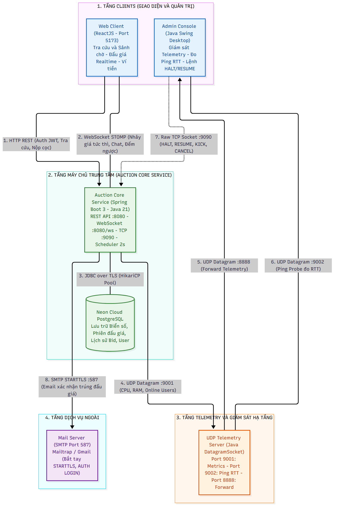
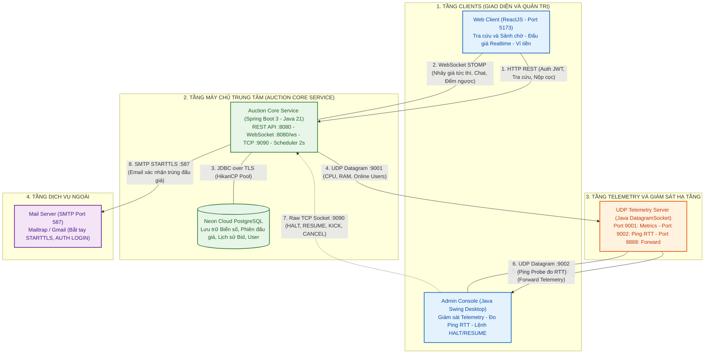

# BÀI TẬP LỚN: LẬP TRÌNH MẠNG  

## SÀN ĐẤU GIÁ TRỰC TUYẾN BIỂN SỐ XE Ô TÔ THEO THỜI GIAN THỰC
### REAL-TIME CAR LICENSE PLATE AUCTION SYSTEM

> 📘 *Báo cáo dự án bài tập lớn môn Lập trình mạng (Java Network Programming) — Học viện Công nghệ Bưu chính Viễn thông (PTIT).*

---

## 🧑‍💻 THÔNG TIN NHÓM

| STT | Họ và Tên | MSSV | Email | Vai trò & Phụ trách kỹ thuật mạng |
|:---:|-----------|:----:|-------|-----------------------------------|
| 1 | **Trần Nhật Nam** | B23DCCN592 | trannhatnam29032k5@gmail.com | **Trưởng nhóm:** Phụ trách **HTTP/REST Server** (:8080), **WebSocket/STOMP Broker Server** (:8080/ws), **JDBC over TLS**, Background Scheduler 2s, Vòng đời & quyết toán phiên đấu giá. |
| 2 | **Nguyễn Văn An** | B23DCCN005 | nguyenvanan2005thptahhnd@gmail.com | **Thành viên:** Phụ trách **WebSocket/STOMP Client**, **HTTP Client**, Giao diện người dùng Web (React/Vite), Thuật toán đồng bộ đồng hồ kiểu NTP & Exponential Backoff, **SMTP/STARTTLS Mailer**. |
| 3 | **Nguyễn Gia Bảo** | B23DCCN075 | baonguyenn.contact@gmail.com | **Thành viên:** Phụ trách **Raw TCP Control Server** (:9090), **UDP Telemetry Server** (:9001/:9002/:8888), Đo độ trễ RTT Ping/Pong, Ứng dụng quản trị **Admin Console** (Java Swing Desktop). |

**Tên nhóm:** Nhóm 05 – Lập trình mạng (Nhóm 5)  
**Giảng viên phụ trách:** Nguyễn Quốc Huy — Khoa CNTT 1  
**Chủ đề đã đăng ký:** Xây dựng hệ thống sàn đấu giá trực tuyến biển số xe ô tô theo thời gian thực (Mô phỏng Nghị định 39/2023/NĐ-CP)

---

## 🧠 MÔ TẢ HỆ THỐNG

Hệ thống là một **nền tảng đấu giá trực tuyến biển số xe ô tô phân tán đa tầng** hoạt động theo thời gian thực (Real-time). Hệ thống giải quyết các bài toán mạng cốt lõi: đồng thời cao (high concurrency), độ trễ cực thấp (low latency < 50ms), đồng bộ thời gian đa điểm, đo lường viễn trắc mạng và kênh điều hành khẩn cấp độc lập.

### Các tính năng chính:
- **Sảnh chờ & Danh mục thời gian thực (Realtime Lobby):** Cập nhật ngay lập tức mức giá và số lượt trả giá trên toàn bộ biển số đang đấu qua kênh WebSocket mà không cần reload trang.
- **Phòng đấu giá trực tiếp (Live Bidding Room):**
  - Nhảy giá đa điểm tức thời (Broadcast qua STOMP Topic).
  - Đồng hồ đếm ngược từng giây đồng bộ hóa với Server theo thuật toán bù trừ độ trễ mạng (NTP-like Clock Sync).
  - Vòng gia hạn phút chót (Anti-Sniping): Tự động cộng thêm 30 giây khi có lượt đặt giá hợp lệ trong 10 giây cuối cùng.
  - Live Chat nội bộ giữa các đấu giá viên trong phòng.
  - Chuông thông báo realtime (Outbid Alert, Topup Success, Won Auction).
- **Quyết toán và hoàn cọc tự động (Automated Lifecycle & Settlement):**
  - Scheduler quét định kỳ mỗi 2 giây, tự động kích hoạt phiên khi đến giờ bắt đầu.
  - Khi hết giờ: Tự động khóa sổ, xác định người trả giá cao nhất, khấu trừ số dư người thắng và **hoàn trả 100% tiền đặt trước (40.000.000 VNĐ)** cho toàn bộ người thua cuộc.
- **Điều hành khẩn cấp qua Raw TCP Socket (:9090):** Quản trị viên sử dụng Admin Console phát lệnh byte stream trực tiếp (`HALT`, `RESUME`, `KICK`, `UNKICK`, `CANCEL`) để can thiệp phiên ngay tức khắc.
- **Giám sát viễn trắc hạ tầng qua UDP (:9001, :9002, :8888):** Thu thập CPU, RAM, số kết nối trực tuyến bằng gói tin UDP siêu nhẹ; đo đạc độ trễ mạng Round-Trip Time (RTT) qua cơ chế UDP Echo Ping/Pong.
- **Biên bản trúng đấu giá qua SMTP (:587):** Tự động soạn thảo và gửi email xác nhận trúng đấu giá chi tiết tới hòm thư cá nhân của người thắng ngay khi phiên kết thúc.

**Cấu trúc logic tổng quát:**
```text
[Web Client (React)]    <─── HTTP/REST (8080) & WebSocket/STOMP (8080/ws) ───> [Auction Core Service]
[Admin Console (Swing)] <─── Raw TCP Socket (:9090) ─────────────────────────> (Spring Boot / Java 21)
[Admin Console (Swing)] <─── UDP Telemetry (:8888) ◄── [UDP Server (:9001)] ───┘
[Admin Console (Swing)] <─── UDP Echo Ping/Pong RTT (:9002) ──────────────────> [UDP Server]
[Auction Core Service]  ───► SMTP Protocol (:587 / STARTTLS) ────────────────► [Mail Server (Mailtrap/Gmail)]
[Auction Core Service]  <─── JDBC over TLS (:5432) ───────────────────────────> [Neon PostgreSQL Cloud]
```

**Sơ đồ hệ thống:**





---

## ⚙️ CÔNG NGHỆ SỬ DỤNG

| Thành phần | Công nghệ / Thư viện chính | Ghi chú |
|------------|----------------------------|---------|
| **Web Client** | React 18, TypeScript, Vite, Ant Design | Giao diện đấu giá viên và người theo dõi |
| **Giao thức Client** | `@stomp/stompjs`, `sockjs-client`, `axios` | Giao tiếp WebSocket STOMP và HTTP REST |
| **Backend Core Server** | Java 21, Spring Boot 3.x, Spring WebSocket, Spring Data JPA | Máy chủ trung tâm điều phối nghiệp vụ |
| **Kênh điều hành khẩn cấp** | `java.net.ServerSocket`, `java.net.Socket` | Lập trình Raw TCP Socket trên cổng 9090 |
| **UDP Telemetry Server** | `java.net.DatagramSocket`, `DatagramPacket` | Thu thập chỉ số hiệu năng và đo Ping RTT |
| **Admin Console** | Java 21, Java Swing, FlatLaf Dark/Light Theme | Ứng dụng Desktop độc lập cho quản trị viên |
| **Gửi mail tự động** | SMTP Socket Client thuần, RFC 5321, RFC 3207 (`STARTTLS`) | Bắt tay TLS và xác thực `AUTH LOGIN/PLAIN` |
| **Cơ sở dữ liệu** | PostgreSQL 16 (Hosted on Neon Cloud) | Kết nối an toàn qua TLS với HikariCP Pool |

---

## 🚀 HƯỚNG DẪN CHẠY DỰ ÁN

### 1. Chuẩn bị môi trường
- **Java Development Kit (JDK):** Java 21 trở lên (Khuyến nghị Microsoft Build of OpenJDK 21).
- **Node.js:** Node 18 trở lên & npm.
- **Apache Maven:** Phiên bản 3.9+ (hoặc dùng `./mvnw` đi kèm trong source).

### 2. Khởi động nhanh (Khuyến nghị trên Windows)
Dự án đã chuẩn bị sẵn các script PowerShell hỗ trợ khởi động nhanh tại thư mục `source/scripts`:

```powershell
# Cách 1: Khởi động tự động cùng lúc cả 4 dịch vụ trong 4 cửa sổ riêng biệt (Khuyến nghị)
.\source\scripts\start-all.ps1

# Cách 2: Khởi động riêng lẻ từng dịch vụ
.\source\scripts\run-udp.ps1    # 1. Khởi động UDP Telemetry Server (Port 9001/9002/8888)
.\source\scripts\run-core.ps1   # 2. Khởi động Auction Core Service (HTTP 8080 / TCP 9090)
.\source\scripts\run-web.ps1    # 3. Khởi động Web Frontend (http://localhost:5173)
.\source\scripts\run-admin.ps1  # 4. Khởi động Admin Console Desktop (Giao diện Java Swing)
```

---

### 3. Khởi động thủ công từng thành phần bằng dòng lệnh

#### A. Khởi động UDP Telemetry Server
```bash
cd source/server/udp-server
mvn compile exec:java -Dexec.mainClass="com.auction.udp.UdpMetricsServerApp"
```

#### B. Khởi động Auction Core Service (Spring Boot)
```bash
cd source/server/auction-core-service
./mvnw spring-boot:run
```
*Server lắng nghe tại `http://localhost:8080` (REST & WS) và TCP Port `9090` (Kênh điều khiển).*

#### C. Khởi động Web Client (ReactJS)
```bash
cd source/client/jnp.fe
npm install
npm run dev
```
*Giao diện người dùng mở tại `http://localhost:5173`.*

#### D. Khởi động Admin Console (Java Swing Desktop)
```bash
cd source/server/admin-console
mvn clean compile exec:java -Dexec.mainClass="com.auction.AdminConsoleApp"
```

---

## 🔗 GIAO TIẾP (GIAO THỨC SỬ DỤNG)

| Endpoint / Cổng | Giao thức | Phương thức / Kênh | Mục đích sử dụng | Dữ liệu trao đổi |
|:----------------|:---------:|:-------------------:|:-----------------|:-----------------|
| `http://localhost:8080/api/auth/*` | **HTTP/1.1** | POST / GET | Đăng ký, đăng nhập tài khoản, xác thực OAuth2 | JSON (Token JWT Bearer) |
| `http://localhost:8080/api/auction/*` | **HTTP/1.1** | GET / POST | Lấy danh sách biển số, chi tiết phiên, nộp tiền ký quỹ | JSON |
| `http://localhost:8080/api/wallet/*` | **HTTP/1.1** | GET / POST | Xem số dư ví, nạp tiền vào ví đấu giá | JSON |
| `ws://localhost:8080/ws` | **WebSocket (STOMP)** | TCP Upgrade (Port 8080) | Kênh kết nối 2 chiều liên tục giữa Web Client và Server | STOMP Frames |
| `/topic/auctions` | **STOMP Broadcast** | SUBSCRIBE / SEND | Cập nhật giá và trạng thái sảnh chờ cho mọi người theo dõi | `BidMessageVO` (JSON) |
| `/topic/auction/{roomCode}` | **STOMP Broadcast** | SUBSCRIBE / SEND | Nhảy bước giá tức thời trong phòng đấu giá | `BidMessageVO` (JSON) |
| `/topic/room/{roomCode}` | **STOMP Broadcast** | SUBSCRIBE / SEND | Sự kiện phòng: Bắt đầu, Gia hạn phút chót, Dừng khẩn cấp, Kết thúc | `RoomEventVO` (JSON) |
| `/topic/room/{roomCode}/chat` | **STOMP Broadcast** | SUBSCRIBE / SEND | Khung trò chuyện Live Chat trực tiếp giữa các đấu giá viên | `ChatMessageVO` (JSON) |
| `/user/queue/notifications` | **STOMP Private** | SUBSCRIBE | Nhận chuông thông báo cá nhân (vượt giá, nạp tiền, trúng thầu) | `NotificationVO` (JSON) |
| `tcp://localhost:9090` | **Raw TCP Socket** | Byte Stream (TCP) | Kênh điều hành khẩn cấp độc lập từ Admin Console | Text Commands: `HALT`, `RESUME`, `KICK`, `UNKICK`, `CANCEL` |
| `udp://localhost:9001` | **UDP Datagram** | DatagramPacket | Core gửi gói tin viễn trắc định kỳ 1s (CPU, RAM, Connections) | UDP Payload String: `METRICS cpu=... ram=... conn=...` |
| `udp://localhost:9002` | **UDP Datagram** | Echo Datagram | Admin Console gửi gói tin PING để đo Round-Trip Time (RTT) | `PING <timestamp>` $\rightarrow$ `PONG <timestamp>` |
| `udp://localhost:8888` | **UDP Datagram** | DatagramPacket | UDP Server chuyển tiếp số liệu và cảnh báo quá tải cho Admin | JSON/String Telemetry Metrics |
| `smtp://sandbox.smtp.mailtrap.io:587` | **SMTP / STARTTLS** | TCP Stream + TLS | Tự động gửi email xác nhận trúng đấu giá tới người thắng cuộc | MIME Message RFC 5321 / RFC 2047 |
| `jdbc:postgresql://...:5432` | **JDBC over TLS** | TLS Socket | Kết nối lưu trữ cơ sở dữ liệu đám mây Neon PostgreSQL | SQL Queries qua HikariCP |

---

## 📊 KẾT QUẢ THỰC NGHIỆM

Toàn bộ hệ thống đã được kiểm thử toàn diện với bộ unit/integration test tự động và kịch bản thực tế:

| Hạng mục kiểm thử | Kịch bản thực hiện | Kết quả ghi nhận | Trạng thái |
|:------------------|:-------------------|:-----------------|:----------:|
| **Toàn bộ Test Suite** | Chạy `mvn test` trên toàn bộ source backend | **53/53 tests PASSED (0 failures, 0 errors)** | ✅ Đạt 100% |
| **Độ trễ truyền tin WebSocket** | Đo thời gian từ lúc gửi bid đến khi toàn bộ client trong phòng nhận được | **< 15ms (Localhost), < 45ms (Cloud DB)** | ✅ Cực nhanh |
| **Độ trễ viễn trắc mạng UDP (RTT)** | Đo độ trễ qua kênh Ping/Pong cổng 9002 từ Admin Console | **0 - 2ms (Mạng LAN), cột sóng hiển thị Xanh ổn định** | ✅ Ổn định |
| **Chống bắn tỉa (Anti-Sniping)** | Đặt giá ở giây thứ 59:52 (còn 8s) | Đồng hồ tự động gia hạn thêm +30 giây chính xác | ✅ Chính xác |
| **Chống tự đè giá & Khoá cọc** | Người đang dẫn đầu cố tình đặt giá tiếp theo | Nút đặt giá bị vô hiệu hoá, chặn lỗi `ALREADY_HIGHEST_BIDDER` | ✅ An toàn |
| **Can thiệp khẩn cấp (HALT/RESUME)**| Phát lệnh `HALT` qua TCP :9090 | Toàn bộ client đóng băng đếm ngược, khóa nút đặt giá tức thì | ✅ Chuẩn xác |
| **Cưỡng chế ngắt kết nối (KICK/UNKICK)**| Phát lệnh `KICK 1 <room>` qua TCP :9090 | User 1 bị đuổi khỏi phòng, chặn đặt giá/chat; `UNKICK` mở khóa lại | ✅ Hoạt động |
| **Quyết toán & Hoàn cọc tự động** | Phiên đếm về 0s | Chốt người thắng, khấu trừ tiền, **hoàn trả cọc 100% cho người thua** | ✅ Đúng nghiệp vụ |
| **Gửi email trúng thầu qua SMTP** | Phiên kết thúc có người trả giá cao nhất | Soạn thảo và gửi thành công email xác nhận qua SMTP cổng 587 | ✅ Thành công |

---

## 🧩 CẤU TRÚC DỰ ÁN

```text
assignment-network-project/
├── README.md                    # Tài liệu tổng quan dự án (file này)
├── INSTRUCTION.md               # Quy định bài tập lớn từ Giảng viên (giữ nguyên gốc)
├── statics/                     # Thư mục chứa hình ảnh minh hoạ, logo, sơ đồ
│   ├── diagram.png              # Sơ đồ kiến trúc mạng hệ thống
│   └── logo.png                 # Logo hệ thống sàn đấu giá
├── source/                      # Thư mục chứa toàn bộ mã nguồn
│   ├── .gitignore
│   ├── docs/                    # Tài liệu đặc tả kỹ thuật, hướng dẫn quy chuẩn & ghi chú
│   ├── scripts/                 # Các script PowerShell hỗ trợ khởi động nhanh hệ thống
│   │   ├── run-udp.ps1          # Khởi động UDP Telemetry Server
│   │   ├── run-core.ps1         # Khởi động Auction Core Service
│   │   ├── run-web.ps1          # Khởi động Web Client
│   │   ├── run-admin.ps1        # Khởi động Admin Console Desktop
│   │   └── start-all.ps1        # Khởi động đồng thời cả 4 dịch vụ trong 4 cửa sổ riêng
│   ├── client/                  # Module phía Client
│   │   ├── README.md            # Hướng dẫn chi tiết cho module Client
│   │   └── jnp.fe/              # Ứng dụng Web Client (ReactJS, TypeScript, Vite)
│   │       ├── src/
│   │       │   ├── apps/        # Các trang: sảnh chờ, phòng đấu giá, ví, profile
│   │       │   ├── shared/      # WebSocket client, HTTP services, Token manager
│   │       │   └── ...
│   │       └── package.json
│   └── server/                  # Module phía Server
│       ├── README.md            # Hướng dẫn chi tiết cho module Server
│       ├── auction-core-service/# Máy chủ trung tâm (Spring Boot 3, HTTP, WebSocket, TCP 9090, SMTP)
│       ├── admin-console/       # Ứng dụng quản trị Desktop (Java Swing, TCP 9090, UDP 8888, SMTP)
│       └── udp-server/          # Máy chủ viễn trắc hiệu năng & Ping RTT (Java UDP DatagramSocket)
```

---

## 🧩 HƯỚNG PHÁT TRIỂN THÊM

- [x] Tích hợp cơ chế tự động mở và chốt phiên, hoàn cọc tự động qua Background Scheduler.
- [x] Tích hợp kênh giám sát viễn trắc CPU/RAM và đo RTT qua giao thức UDP không kết nối.
- [x] Tích hợp điều khiển khẩn cấp phòng đấu giá qua Raw TCP Socket cổng riêng biệt.
- [x] Tích hợp gửi email xác nhận kết quả trúng đấu giá tự động qua giao thức SMTP (STARTTLS).
- [ ] Triển khai cụm máy chủ chịu tải cao sử dụng Redis Pub/Sub kết hợp Spring WebSocket Relay.
- [ ] Bổ sung mã hóa đầu cuối (E2EE) cho tin nhắn trò chuyện nội bộ trong phòng đấu giá.
- [ ] Tích hợp cổng thanh toán trực tuyến liên ngân hàng (VNPay / VietQR) để nạp ví tự động.

---

## 📝 GHI CHÚ

- Repository tuân thủ nghiêm ngặt cấu trúc thư mục và quy định tại file `INSTRUCTION.md`.
- Hệ thống cơ sở dữ liệu đám mây PostgreSQL (Neon) được cấu hình kết nối tự động sẵn sàng trong `application.yaml`, sinh viên và giảng viên có thể chạy ngay mà không cần cài đặt database local.
- Toàn bộ 53/53 ca kiểm thử tự động đã được xác minh hoạt động chính xác trước khi nộp bài.

---

## 📚 TÀI LIỆU THAM KHẢO

1. **RFC 6455:** The WebSocket Protocol (IETF Standard).
2. **STOMP Protocol Specification:** Simple Text Oriented Messaging Protocol (Version 1.2).
3. **RFC 768:** User Datagram Protocol (UDP Specification).
4. **RFC 5321 & RFC 3207:** Simple Mail Transfer Protocol (SMTP) and SMTP Service Extension for Secure SMTP over Transport Layer Security.
5. **Nghị định 39/2023/NĐ-CP:** Quy định chi tiết một số điều Nghị quyết số 73/2022/QH15 về thí điểm đấu giá biển số xe ô tô.
6. **Spring Framework Documentation:** Spring WebSockets, STOMP Architecture, and Spring Security 6.
